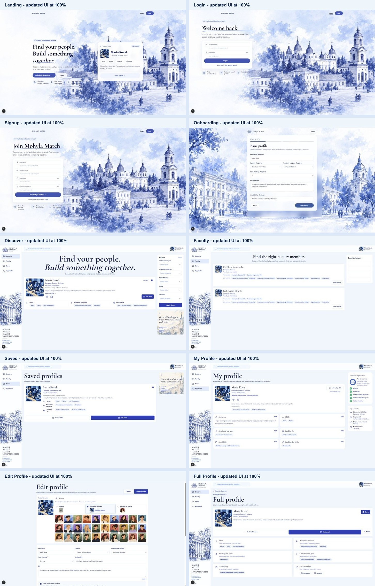
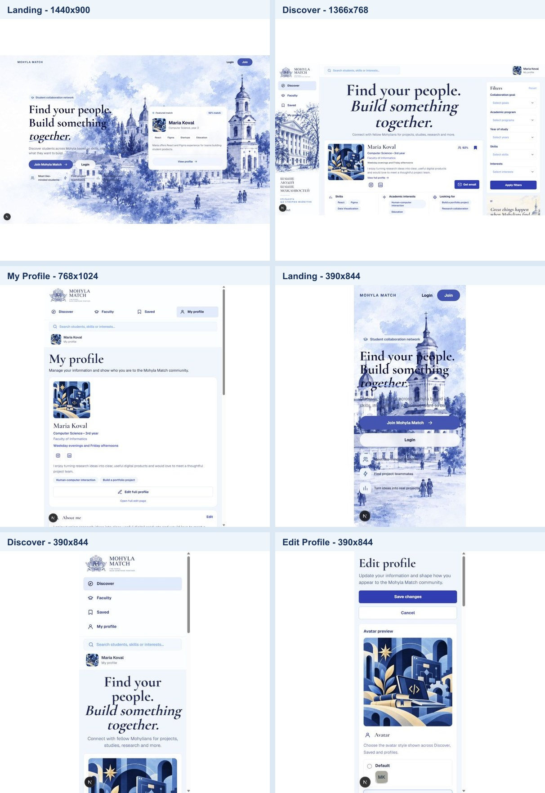

# UI density fine-tuning

This pass follows the broader density work in PR #88 and refines typography,
controls, icons, chips, and panel padding without scaling the document or
changing application behavior.

## Shared sizing

- Body text: 14px
- Filter labels: 13px
- Filter headings: 22px
- Buttons: 13px, 42-44px tall depending on viewport
- Dropdowns: 13px, 46px tall
- Standard icons: 18px
- Small icons: 14px
- Chips: 12px with shared compact padding
- Card padding and internal gaps: reduced by approximately 5-10%

The sizing is centralized in `src/app/globals.css` and consumed through the
shared `mm-*` utility classes. Existing card and page container widths remain
unchanged.

## Visual comparison

### Before (PR #88 at 100%)

### After (fine-tuned at 100%)

## Browser verification

The real shared components were rendered with synthetic fixture data at:

- 1920x1080
- 1440x900
- 1366x768
- 768x1024
- 390x844

Coverage included Landing, Login, Signup, Onboarding, Discover, Faculty,
Saved, My Profile, Edit Profile, and Full Profile. All five Discover filters
and all four Faculty filters were opened at every viewport.

Results:

- 50 page/viewport states checked
- 0 horizontal overflow cases
- 0 interactive elements outside the viewport
- 45 dropdown openings checked, with 0 clipped horizontally
- Landing, Login, and Signup remain viewport-height at desktop sizes
- Mobile pages retain natural vertical scrolling and accessible controls

The temporary local-only fixture route and screenshot script were deleted
after verification and are not part of the application.
