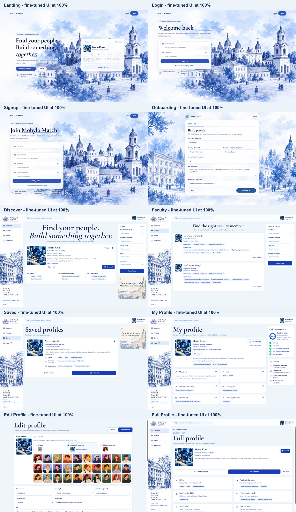
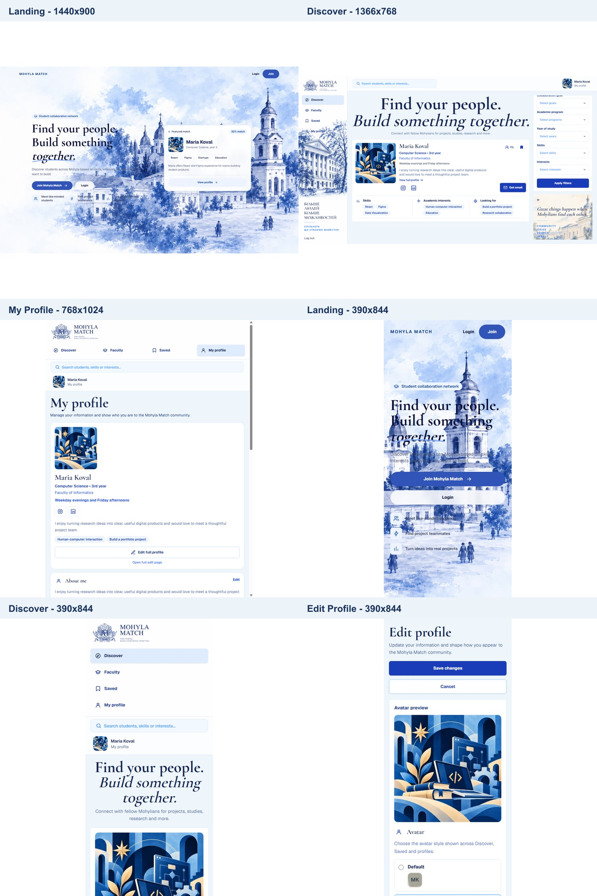
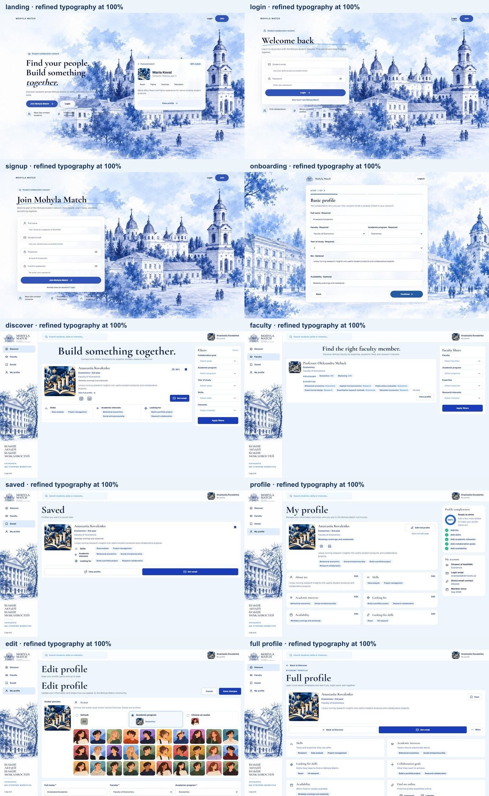
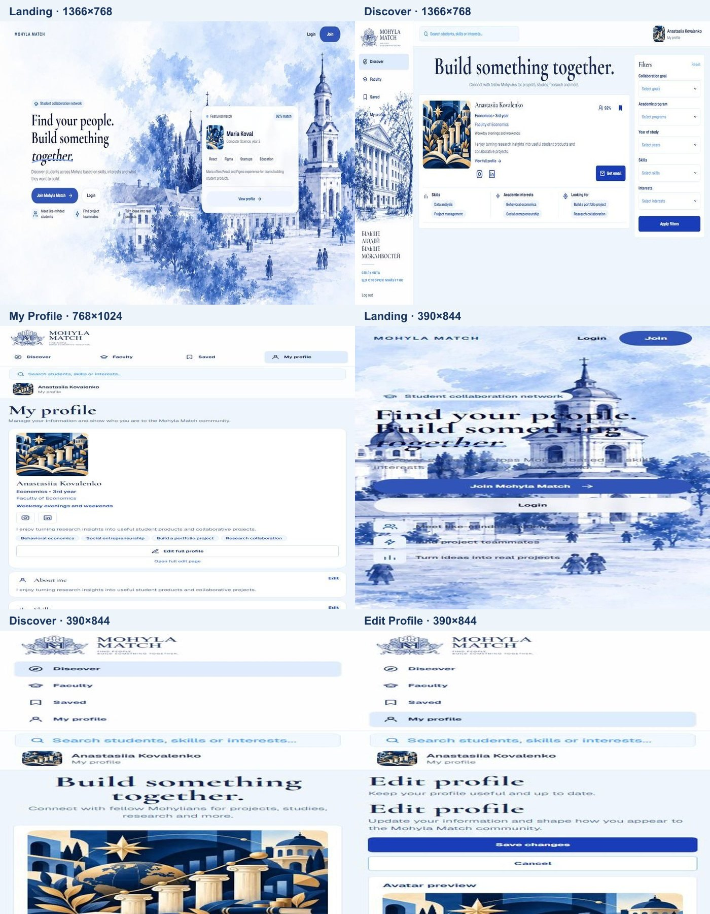

# Global typography refinement

This pass continues the density work from PR #89 and makes the typography
approximately 10-12% more compact at 100% browser zoom. It does not scale the
document and does not change card, column, sidebar, avatar, icon, button, or
dropdown dimensions.

## Shared typography

- Desktop body text: 13px
- Mobile body text: 14px minimum
- Desktop form and dropdown text: 12px
- Mobile form text: 16px minimum to prevent iOS Safari zoom
- Filter and panel titles: 20px
- Profile names: 22px
- Buttons and filter labels: 12px
- Chips: 11px
- Discover hero: 70px at 1920px and 68px at 1440px / 1366px

The responsive values and line heights are centralized in
`src/app/globals.css` and consumed through shared `mm-*` typography classes.

## Visual comparison

### Before (PR #89 at 100%)

### After (refined typography at 100%)

## Browser verification

The real shared components were rendered with synthetic local fixture data at:

- 1920x1080
- 1440x900
- 1366x768
- 768x1024
- 390x844

Coverage included Landing, Login, Signup, Onboarding, Discover, Faculty,
Saved, My Profile, Edit Profile, Full Profile, and Matches. Every Discover and
Faculty filter dropdown was opened at every viewport.

Results:

- 55 page/viewport states checked
- 45 dropdown openings checked
- 0 horizontal overflow cases
- 0 clipped interactive controls
- 0 browser runtime errors
- Mobile body text stayed at or above 14px
- Mobile text fields stayed at or above 16px

The temporary local-only visual fixture and screenshot scripts were deleted
after verification and are not part of the application.
